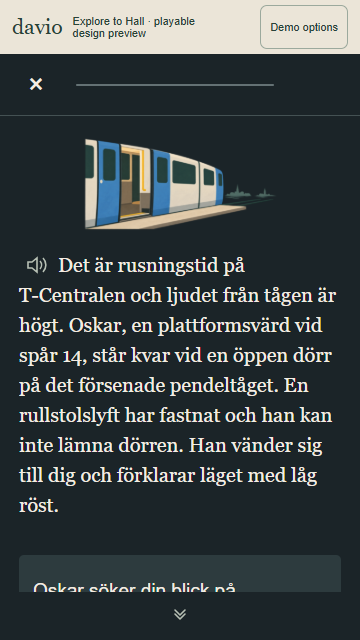
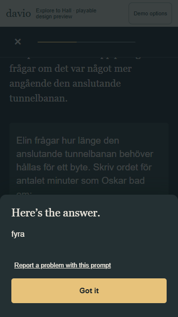
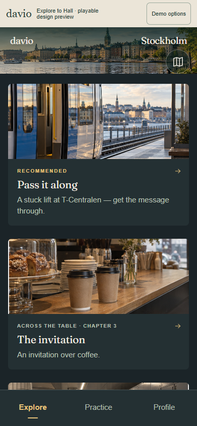
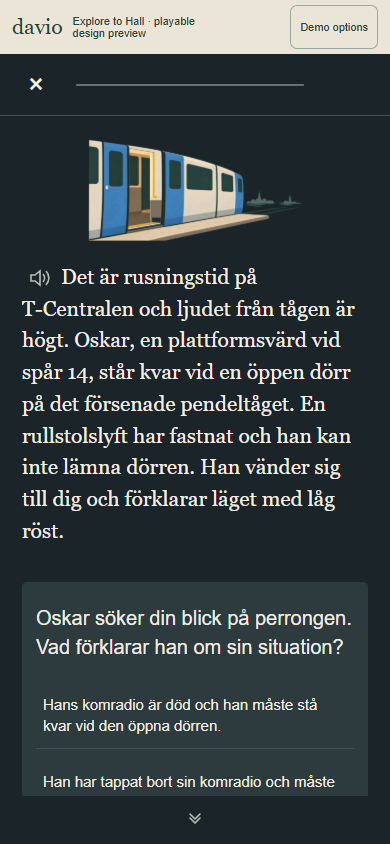
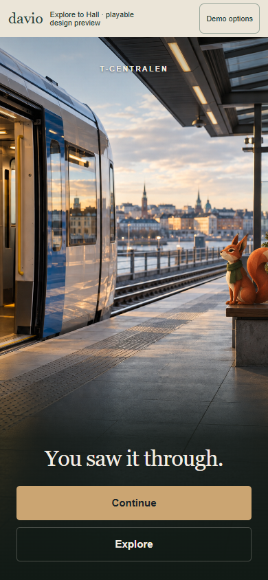

<!-- Hallmark · pre-emit critique: P5 H4 E4 S5 R5 V3 (report self-check, not an app score) -->
# Hallmark trial: Explore and Sitting

**Decision: borrow specific review checks; do not adopt Hallmark as a required workflow.** The Dusk journey has visual weaknesses that the first report missed: narration overwhelms the response hierarchy, answer feedback gives its chrome more emphasis than the language answer, and the imagery changes rendering language across the journey. The measured Moss focus defect also stands. The visual findings warrant review; passing browser checks and approved patterns do not establish visual finish.

Audit date: 21 October 2026. Work: [Davio #150](https://github.com/David-Ernstsson/Davio/issues/150). This revised report re-examines the same-day archived captures and verified served sources. It is not a second full browser sweep. The lead also [spot-checked live Dusk typography](evidence/dusk-rereview.json) at 390×844: passage 21 px / 31.71 px Georgia, task 20 px / 28.6 px Arial, choice 15 px / 21 px Arial, warm passage ink `rgb(243,237,227)`, agreeing with the archived source. No application, published lesson, API, type, mockup or skill integration changed.

The initial review over-weighted conformance and technical reachability, then treated approved choices as reasons to dismiss their visual execution. That was an incomplete visual audit. Its unqualified claim that the journey was visually coherent is withdrawn; the current verdict distinguishes a useful overall concept from unresolved hierarchy and image craft. The superseded raw pass is retained at the end; the current judgments and disposition are below.

## Baseline and reproducibility

The browser target was [the hosted Explore → Sitting → Hall preview](https://explore-hall-demo.davio-gym.pages.dev/), successfully loaded with headless Microsoft Edge **155.0.4283.62**, Playwright, Windows, device scale factor 1, desktop pointer/keyboard defaults. CSS viewports were **390×844**, **360×640**, **320×844**, **375×844**, **414×844**, **768×1000**. At 768 the preview intentionally retains its 390 px demonstration canvas; this checks the surrounding host at 768, not a tablet-native learner layout. The external demo toolbar takes 54 px from the two phone viewports.

The supplied candidate worktree was **e4f83a1a71e8401a580641fcd1bb1cfcdc74f0c2**, with only unrelated untracked prototype directories. It was inspected read-only and was not the deployed version. Main checkout was **d9e383e3d0bf028fd217d081edc2e0827c45731a**, with extensive pre-existing deletions. [Main status](evidence/main-status.txt) and [candidate status](evidence/candidate-status.txt) were recorded; no restore, reset or clean occurred.

Before assigning code locations, the browser request API downloaded the served core assets. **HTML, app.js and styles.css match commit `98df0c68469dfea382ddc23a91f83dd72cd075a7` after CRLF→LF normalization, with no other transformation.** The served palette files match that same commit’s `src/web/src/swedish-practice-grammar.mockup/palette.css` and `palette.mjs`. The served byte hashes and normalized hashes are retained separately in [baseline.json](evidence/baseline.json) and [source-manifest.json](evidence/source-manifest.json). This is a verified core-source match, not proof that every image, audio recording, build input or evaluator backend is identical to that commit.

| Served file | SHA-256 of actual served bytes |
| --- | --- |
| `index.html` | `3b09df9000f86f7e1b615c0db3e952b045305d48cd5078f55559563a88dd991c` |
| `app.js` | `d1eba3e2873325e887bce36f87aeae9c8dcccc4eb363d9731be133158de1669e` |
| `styles.css` | `907fb71a5a5a205cd4883ba349286390e2033cd5d8900cca833c5ff35c7ac2a4` |
| `palette.css` | `a1b3c13c196173b95d9fb16c1944f012698dd6102a4c1e1a0810c42b204a5b30` |
| `palette.mjs` | `2c040061f4e1549abbb796b4e0433ce0ba3fc911341af0791ff9fcd2c0f1c79c` |
| Generated `lesson-data.json` | `5b57f903a901b6c2b4da8507d26837de6400c2cb8bd1b5922de2aed4aa5330b2` |

The generated lesson snapshot identifies Published Edition `f255244141de2040`; it includes the separately labelled `prototype-colleague-message-v1` Compose fixture. The snapshot was archived, not falsely assigned a tracked source match. [Served files](evidence/hosted-index.html) are retained beside the manifest.

Hallmark was read from an **isolated temporary sparse clone**, `tmp/hallmark-upstream/skills/hallmark`, at **[13ac0ec7e148655948100b6396439e481361d690](https://github.com/Nutlope/hallmark/tree/13ac0ec7e148655948100b6396439e481361d690/skills/hallmark)**, version 1.1.0. Read: `SKILL.md`, `references/verbs/audit.md`, `anti-patterns.md`, `slop-test.md`, `responsive.md`, `interaction-and-states.md`, and `contract.md`. Their file fingerprints are in the source manifest. The audit verb is an instruction workflow: this agent performed the pass; no separate Hallmark scanning service or executable was run. No permanent installation or `.hallmark` memory was created.

Reproduction scripts are preserved in [evidence/harness](evidence/harness/). They use the bundled Playwright runtime and installed Edge; paths record this Windows environment. The command sequence `node <harness>/probe.mjs`, `node <harness>/capture.mjs`, `node <harness>/capture.mjs --extras`, `node <harness>/analyze.mjs` records the **original-run trace, not a safe rerun instruction**: the saved scripts hardcode `C:/Git/Davio` output paths and would overwrite this dated evidence. For a rerun, copy the harness into a separate scratch location and use a separate source checkout, preserving this report. Edit the hardcoded `root`/`out` paths in probe, capture, extras and analyze to a fresh output directory, update the Playwright runtime path as needed, and create that output's `evidence` and `screenshots` directories. Acquire Hallmark at exact commit `13ac0ec7e148655948100b6396439e481361d690` in the analyzer's expected temporary `tmp/hallmark-upstream` input, or change that input path too. Only then run the copied harness from the separate checkout. Browser/network execution required sandbox approval. The live URL may change; the archived served bytes and immutable source links identify what this report actually inspected. The initial capture harness lost a seed on reload because the page persisted its old state on unload; it was corrected to seed at initialization and assert the restored index. The final run completed with **118 main records**, **24 extra records**, **129 PNG captures** and no page errors in the six-width main pass.

## Governing meaning and overall assessment

Started at the [current journey index](../../product-experience/README.md#current-swedish-first-tryable-journey), then read [Explore flow](../../product-experience/explore-flow.md), [focused screen decision](../../product-experience/swedish-explore-screen-decision.md), [Explore mockup specification](../../product-experience/swedish-explore-mockup-spec.md), [Sitting](../../product-experience/sitting.md), [screen consistency](../../product-experience/screen-consistency.md), [brand world](../../product-experience/brand-world.md) (Editorial Atlas, Desired world, companion and restraint), [Hall](../../product-experience/hall.md), [learning philosophy](../../product-experience/learning-philosophy.md), and the [product pack entry](../../product-pack/README.md). Governing file hashes are recorded at the main revision above. The revised pass also applied the shared [Delivery product-acceptance standard](https://github.com/David-Ernstsson/Davio-content/blob/master/.agents/skills/delivery/references/product-acceptance.md): product fit first, separate clarity and visual judgments, and approved-brief conflicts reported rather than excused.

**Product fit:** the overall concept works. Explore's photographic invitations make entering a situation plausible, Sitting gives language sustained attention, and Hall returns to the place as the reward. The prose, response and close are related parts of a world rather than a dashboard of exercises. This is a useful direction, but its rendering does not yet consistently deliver the quiet adult reading hierarchy and visual continuity it promises.

**Clarity judgment:** Explore's first row and the ongoing Continue are discoverable; the other invitations remain browseable. The lower list mixes scene entries with compact Path and Speed Test entries, so calling it an undifferentiated card template would overstate the evidence. In Sitting, first choice, retry, answer reveal, technical failure and continuation are distinguishable. Browser evidence shows that choices and Submit remain reachable by scrolling, and no future story is prematurely revealed. These are interaction checks, not evidence that learners notice the intended task, understand the chevrons or learn from the feedback. The answer-reveal hierarchy below is a clarity risk inferred from its composition, not a measured comprehension failure.

**Visual-quality judgment:** Explore is the strongest ordinary composition: photographs lead, short Fraunces names and plain interface copy have distinct jobs, and the modest header does not compete with the list. Initial and ongoing states differ subtly, but their authorized wording and action are visible; no extra resume badge or new layout is justified by this pass. Sitting is weaker. High-contrast, large Georgia narration has almost the visual force of a headline across entire paragraphs, while the task and choices feel appended below it. At 360×640 the opening is mostly narration with only a sliver of the response heading visible, and the typed state shows only the top of the field; the growing-page model permits scrolling, but the resulting proportion still deserves design judgment. The answer-reveal sheet has a similar hierarchy imbalance: its generic heading and action dominate the small target-language answer. Hall alone is a resolved, calm close with legible actions and a plausible place reward. Across the journey, however, photo → flat train artwork → photographic scene with a sculpted squirrel reads as a change of illustration system, not simply a change of crop.

**Baseline drift:** the deployed header still shows `davio` at upper left and a right-side circled World. Current Explore flow and screen consistency instead specify bare World at upper left. See [initial390](screenshots/explore-initial-390.png), [verified app.js line 109](https://github.com/David-Ernstsson/Davio/blob/98df0c68469dfea382ddc23a91f83dd72cd075a7/prototypes/explore-hall/app.js#L109) and [styles.css line 3](https://github.com/David-Ernstsson/Davio/blob/98df0c68469dfea382ddc23a91f83dd72cd075a7/prototypes/explore-hall/styles.css#L3). This is known deployed-version drift, not a new Hallmark discovery. Story, Path and Speed Test rows are visual fixtures, not proof those lessons are playable. Known passage/question evidence gaps also prevent treating the preview as validated teaching content.

## Coverage and evidence

| Check | Browser evidence and conclusion |
| --- | --- |
| Six widths | [Width board](evidence/board-widths.jpg), [additional-width response board](evidence/board-responsive-states.jpg); initial, bottom, ongoing, opening, choice end, long reading/end, typed and feedback captures at every listed width. Main records report no root horizontal overflow and no page errors. At768 the older deployed sheet is fixed to the browser bottom rather than the demonstration canvas: [768 answer](screenshots/feedback-answer-768.png). This is an additional old-preview presentation limitation, not evidence of a native tablet layout or a new Hallmark-derived learner defect. |
| Initial / ongoing Explore | [390 ongoing](screenshots/explore-ongoing-390.png), [360 ongoing](screenshots/explore-ongoing-360.png); one ongoing row first and one Continue. Scroll keeps the final row above the fixed tabs: [320 bottom](screenshots/explore-bottom-320.png), [768 bottom](screenshots/explore-bottom-768.png). |
| Sitting opening / long reading / choice | [Sitting board](evidence/board-sitting.jpg); [360 choice end](screenshots/sitting-choice-end-360.png), [390 long end](screenshots/sitting-long-end-390.png). Long-state seeds use the real hosted lesson index and renderer; they do not claim every prior answer was earned. |
| Ordinary feedback / resume | [Feedback board](evidence/board-feedback.jpg); actual wrong choice → Try again → correct choice → authored continuation, followed by Leave → ongoing Explore. Final answer reveal follows a submitted unrelated short answer; technical failure uses the existing Demo options fail-next-check control. |
| Other available feedback | [Extra board](evidence/board-extra.jpg); [checking360](screenshots/compose-checking-360.png), [unchecked360](screenshots/compose-unchecked-360.png), [info360](screenshots/compose-info-360.png), [paused360](screenshots/reading-paused-360.png), [resumed360](screenshots/reading-resumed-360.png). Checking uses an intercepted held request followed by injected unchecked JSON. Info and paused states use saved-state fixtures. These verify native UI rendering and controls, not actual evaluator outcomes or interruption timing. |
| Focus and reachable actions | [Moss360 keyboard ring](screenshots/moss-feedback-360.png), [Dusk390 modal focus](screenshots/reading-paused-focus-390.png), [retry focus](screenshots/retry-focus-360.png). Sheet focus remains inside the modal under Tab/Shift+Tab; the underlying phone is inert. Retry returns focus to the choice. This is bounded web keyboard evidence, not TalkBack coverage. |
| Scroll / no future passage | [scroll-assist-end360](screenshots/scroll-assist-end-360.png), [extra-checks.json](evidence/extra-checks.json): first page contains passage index 0 only, navigation reaches all three choices; 390 scroll 0→163, 360 scroll 0→384. Scroll position, document heights and control bounds are recorded. |
| Enlarged text | [Dusk/Moss text board](evidence/board-text200.jpg), [typed360](screenshots/text200-typed-360.png), [leave360](screenshots/text200-leave-360.png). The harness snapshots every rendered element’s computed font size and numeric line height, then doubles each once, including task labels, tabs and controls. It does not rely on the passage-only `--text-scale` hook. Reading/choices grow and scroll; input/Submit remain reachable. The external demo toolbar clips at this stress scale; this is presentation harness chrome, not a learner surface finding. The old learner wordmark/place become close but no overlap is asserted. CSS text stress is not browser user-font settings or Android font scaling certification. |
| Shared colors / contrast | [contrast.json](evidence/contrast.json), [source manifest](evidence/source-manifest.json). Solid effective-ancestor text pairs measured at least 5.93:1 outside disabled Submit controls. Disabled Submit is excluded from the normal text criterion. No all-pixel contrast claim is made for photographs, translucency, every icon or uninspected states. The explicit focus/background pair fails only in Moss. |
| Hall continuity | [390 Hall](screenshots/hall-390.png), [360 Hall](screenshots/hall-360.png). Hall is reached from seeded final exhausted-repair state; the bench image, passive companion, short acknowledgement and primary Continue/secondary Explore remain legible. Their cross-screen image treatment is critiqued below; this verifies the close’s appearance, not a fully evaluated Compose completion. #122 explicitly permits the different contained train opening; do not “repair” it to the same photograph. |

Machine detail: [browser-checks.json](evidence/browser-checks.json), [extra-checks.json](evidence/extra-checks.json). Original screenshots remain available beside the boards, so thumbnail boards are not the only visual evidence.

## Ranked findings

The two major Dusk hierarchy findings are visible together here:

| Narration and learner turn at 360×640 | Answer reveal at 360×640 |
| --- | --- |
|  |  |

The pale 54 px presenter toolbar is external demo chrome, not part of the learner screen. The selected 48 px reading-navigation footer also reduces the visible reading area; this audit critiques the resulting composition without calling either an overflow or blocked-response defect.

These are judgments of the inspected artifact. Hallmark's useful hooks are named below, but the first three are supplemental hierarchy/craft judgments, not invented matches to its named anti-pattern list. Severity describes the issue's weight in this audit; it does not certify a measured learner effect.

### 1. Dusk narration has display-like prominence instead of a quiet reading role — major

**Observed and evidence:** in [opening390](screenshots/sitting-opening-390.png), [long360](screenshots/sitting-long-360.png), [typed360](screenshots/sitting-typed-360.png) and the [Sitting board](evidence/board-sitting.jpg), near-white Georgia occupies most of the screen with short lines and repeated large paragraphs. The task is a similar size in a flatter sans-serif; the choices are much smaller. Narration therefore gets the strongest continuous emphasis even when the learner's turn has arrived. The text is regular weight; this finding does not claim it is bold. Reading is naturally primary while the learner reads; the issue is the uniform bright emphasis given to every narrative report and the weak differentiation when the learner's turn arrives. The existing panel successfully groups task and responses, but grouping alone does not resolve those roles.

**Source and Hallmark rule:** `.passage` at [styles.css line 4](https://github.com/David-Ernstsson/Davio/blob/98df0c68469dfea382ddc23a91f83dd72cd075a7/prototypes/explore-hall/styles.css#L4) uses warm `--ink` and 21 px / 1.51 serif; scaling at [line 33](https://github.com/David-Ernstsson/Davio/blob/98df0c68469dfea382ddc23a91f83dd72cd075a7/prototypes/explore-hall/styles.css#L33) and the short-width override at [line 37](https://github.com/David-Ernstsson/Davio/blob/98df0c68469dfea382ddc23a91f83dd72cd075a7/prototypes/explore-hall/styles.css#L37) retain that relationship. `.prompt h2` switches to interface type at [line 44](https://github.com/David-Ernstsson/Davio/blob/98df0c68469dfea382ddc23a91f83dd72cd075a7/prototypes/explore-hall/styles.css#L44). Hallmark's [Hierarchy and Execution axes](https://github.com/Nutlope/hallmark/blob/13ac0ec7e148655948100b6396439e481361d690/skills/hallmark/references/slop-test.md#pre-emit-self-critique-six-axes) and [typography principles](https://github.com/Nutlope/hallmark/blob/13ac0ec7e148655948100b6396439e481361d690/skills/hallmark/references/typography.md#principles) prompt this critique. Its 45–75 character gate is not imposed literally on a phone.

**Learner consequence:** the page asks for sustained headline-level attention, with less visual relief between reading and doing. On the short phone the response arrives largely below the fold, making the transition to the learner's turn less apparent. This is a supported visual judgment; the existing scroll checks show that the response remains reachable.

**Correction and conflict:** prototype quieter narration through an appropriate muted reading ink and a body-scale comparison, then compare opening, long passage and typed response at both phone sizes with every published word intact. Preserve comfortable readability, the response panel and authored speech distinctions. This partly exposes an execution mismatch with [Sitting's accepted quiet narrator role](../../product-experience/sitting.md#accepted-activity-hierarchy--2026-10-05). Any change to the passage metrics preserved under the bounded #100 trial requires owner review; the report does not authorize it. Do not infer dialogue, truncate the passage or impose a one-screen lesson to make the composition fit.

### 2. Answer feedback makes the language answer secondary to generic UI — major

**Observed and evidence:** [answer360](screenshots/feedback-answer-360.png) and [answer390](screenshots/feedback-answer-390.png) make “Here's the answer.” the typographic lead at 22 px. The actual answer, `fyra`, is a normal 16 px paragraph; a prominent filled Got it action and a report link complete the sheet. The retry and technical-failure sheets work better because communicating their status is their purpose; this finding concerns the answer-reveal state specifically. The message is readable, but the hierarchy emphasizes the container's announcement and dismissal more than the language the learner needs to notice.

**Source and Hallmark rule:** [app.js line 213](https://github.com/David-Ernstsson/Davio/blob/98df0c68469dfea382ddc23a91f83dd72cd075a7/prototypes/explore-hall/app.js#L213) renders `item.expected` as an undifferentiated `
`. [styles.css line 6](https://github.com/David-Ernstsson/Davio/blob/98df0c68469dfea382ddc23a91f83dd72cd075a7/prototypes/explore-hall/styles.css#L6) gives `.bottom-sheet h2` 22 px, `.bottom-sheet p` 16 px and `.sheet-action` a 50 px minimum. This fails the intended attention order under Hallmark's Hierarchy/Restraint axes and the existing Delivery hierarchy check; it is not one of Hallmark's named tells.

**Learner consequence:** a learner can acknowledge the repair while giving the short target-language answer less attention than the generic heading and button. That is a risk inferred from visible emphasis, not evidence that anyone actually missed or forgot `fyra`.

**Correction and conflict:** give the expected answer its own response-content role with greater prominence and breathing room, subordinate the generic introduction, and keep reporting visually secondary. Retain the required answer reveal, report action and Got it stop. This is an execution correction to emphasis inside the accepted sheet, not a proposal to remove repair or add explanation that the published content does not supply. No approved behavior requires the current 22-versus-16 px relationship.

### 3. The entry, reading opener and close do not yet share one rendering language — minor

**Observed and evidence:** compare [Explore390](screenshots/explore-initial-390.png), [opening390](screenshots/sitting-opening-390.png) and [Hall390](screenshots/hall-390.png), also visible in the [Sitting](evidence/board-sitting.jpg) and [feedback](evidence/board-feedback.jpg) boards. Explore promises a richly lit photographic station. Sitting replaces this with a small, simplified flat train cutout. Hall returns to a lush photographic-looking station with a saturated, sculpted squirrel. The palette relates them, and the train setting is recognizable, but detail, material and rendering technique change abruptly. The opening artwork looks especially thin beside the richer scenes that bookend it.

| Explore | Sitting opener | Hall |
| --- | --- | --- |
|  |  |  |

**Source and Hallmark rule:** `.chapter-photo.station` and its contained `station-warm.png` are at [styles.css line 4](https://github.com/David-Ernstsson/Davio/blob/98df0c68469dfea382ddc23a91f83dd72cd075a7/prototypes/explore-hall/styles.css#L4); `.hall.bench .hall-scene` uses `bench-scene.png` at [line 5](https://github.com/David-Ernstsson/Davio/blob/98df0c68469dfea382ddc23a91f83dd72cd075a7/prototypes/explore-hall/styles.css#L5); the entry station photograph is at [line 3](https://github.com/David-Ernstsson/Davio/blob/98df0c68469dfea382ddc23a91f83dd72cd075a7/prototypes/explore-hall/styles.css#L3). Hallmark's Specificity/Execution axes motivate checking image craft as a system. Its named “AI-illustration look” is not asserted as a literal match: the evidence is discontinuity, not proof that an asset was generated or that illustration is inherently wrong.

**Learner consequence:** the same place feels assembled from different visual products, weakening the immersion and return recognition that should connect the three moments. Hall's passive companion and restrained actions work in isolation; this is a continuity judgment, not a demand for more mascot appearances.

**Correction and conflict:** review the three moments together and test a common material, detail and lighting treatment, with a richer but still modest contained opener as the first comparison. **Founder decision required:** [the explicit #122 exception](../../product-experience/screen-consistency.md#image-progression-agreed-for-the-first-tryable-journey) approves this very artwork and preserves the Hall image/crop/shade. Do not silently restore the old same-photograph rule, replace approved assets or recolor them under palette work. Approval is context for the tradeoff, not evidence that the rendering is finished.

### 4. Moss feedback loses a strong keyboard focus boundary — medium product priority

**Observed:** on the retry sheet, the 3 px focus outline is copper `#e9ac80` over the light Moss overlay `#ead5b5`: **1.375:1**, below the 3:1 check against the adjacent surface described in [W3C non-text contrast guidance](https://www.w3.org/WAI/WCAG22/Understanding/non-text-contrast.html). Dusk's equivalent outline over `#243033` is **8.020:1**. The native action remains reachable and its text is readable; the defect is the weak focus indicator.

**Evidence and Hallmark rule:** [Moss360](screenshots/moss-feedback-360.png), [Moss390](screenshots/moss-feedback-390.png), [contrast calculations](evidence/contrast.json) and [focused control records](evidence/browser-checks.json). The screenshot follows actual keyboard navigation. Hallmark gates 40–41 and its interaction rules require contrast against the computed effective surface.

**Verified source:** [styles.css line 2](https://github.com/David-Ernstsson/Davio/blob/98df0c68469dfea382ddc23a91f83dd72cd075a7/prototypes/explore-hall/styles.css#L2) uses `var(--copper)` for the global focus outline; [shared palette.css line 4](https://github.com/David-Ernstsson/Davio/blob/98df0c68469dfea382ddc23a91f83dd72cd075a7/src/web/src/swedish-practice-grammar.mockup/palette.css#L4) defines the light Moss overlay and copper. Both match the served assets.

**Learner consequence:** a keyboard user repairing a miss has a weaker cue to which action will fire. This is a measured local accessibility defect, unlike the inferred attention risks above.

**Correction and conflict:** use a semantic contrasting ink for focus on the light Moss feedback surface, then measure and recapture retry, answer, technical and leave sheets in both palettes. This is an execution defect with no owner-choice conflict. Shared palette continuity does not require a low-contrast ring.

**Dusk visual finding count: 0 critical · 2 major · 1 minor.** Separately, the measured Moss focus defect retains its **medium product priority**. Four accepted findings in total: three supplemental critique-axis judgments and one supplemental interaction/contrast finding; **0 accepted named anti-pattern tells**. The superseded raw pass below retains its original named-tell count rather than merging those rejected rules into this verdict. No fifth finding was invented to fill the allowance.

## Incremental value and disposition

**Borrow specific checks.** Retain effective-surface focus measurement and the explicit width/state inventory. Borrow the pre-emit questions as a useful second look at hierarchy, execution, specificity and restraint when reviewing the actual journey. This reopened audit shows that those questions can reveal worthwhile visual objections that a compliance-led report missed. It does not show that Hallmark uniquely supplies them or earns permanent installation, a routine cadence or a competing design authority.

| Hallmark contribution | Davio already requires | What this trial demonstrates |
| --- | --- | --- |
| Hierarchy, Execution, Specificity and Restraint critique | Delivery product acceptance explicitly judges hierarchy, grouping, composition and whole-journey fit; screen records require quiet narration and coherent place progression | Three supported visual findings from actually comparing the captures. The incremental value is a compact challenge to maker rationale, not a new product principle. |
| Effective-surface focus contrast | Existing platform and accessibility review | One measured Moss defect and a concrete calculation missing from the inspected palette checks. |
| Named widths and state inventory | Short/normal phone, scaling and interaction-state review | Useful explicit coverage; no newly established overflow or blocked-response defect. |
| Named anti-pattern taxonomy, novelty and structural rotation | Shared kit and governing screen records | No accepted named tell in this artifact. Blanket label caps, no-wrap response text and forced novelty would damage approved information and continuity. |

The inspected [check-palette.mjs](https://github.com/David-Ernstsson/Davio/blob/98df0c68469dfea382ddc23a91f83dd72cd075a7/prototypes/explore-hall/check-palette.mjs#L20) compares text, font, geometry and image invariants and captures a Dusk miss; [check-palette-repair1.mjs](https://github.com/David-Ernstsson/Davio/blob/98df0c68469dfea382ddc23a91f83dd72cd075a7/prototypes/explore-hall/check-palette-repair1.mjs#L8) calculates Hall button and World text contrast. Neither computes the feedback ring/light-overlay pair. That is a specific execution gap. The visual review gap was different: it failed to apply existing product-quality judgment to the rendered result. Hallmark helps phrase that challenge, but this trial does not justify presenting ordinary visual acceptance as a newly discovered Hallmark capability.

**Verdict:** the report is an audit artifact; the Dusk preview is not declared commercially finished. Review the narration and answer hierarchy, take the image-continuity tradeoff to the owner before any asset reversal, and repair the Moss focus contrast. No application changes, installation, production adoption or publication approval follow from this report.

Untested: actual Android device/browser/WebView, touch targets in dp, keyboard resize, system bars/insets, touch interruption, TalkBack announcements, real audio synchronization, real evaluator quality/latency, learner recognition and retention, production performance and complete accessibility conformance. Reduced-motion behavior was source-inspected but not newly browser-tested. The revised visual pass reuses the archived corpus; only the bounded live typography spot check was added.

## Appendix: superseded first-pass raw Hallmark output

The following first-pass output is retained verbatim apart from this heading and status sentence for provenance; its reconciliation and final conclusion are superseded by the review above. It is the agent’s literal audit-rule output, retained separately from the current Davio decisions above. It is not output from an independent Hallmark service. Hallmark’s severity words describe its taste taxonomy; they are not Davio product priorities. Source lines below all refer to verified revision `98df0c68469dfea382ddc23a91f83dd72cd075a7`.

**Pre-flight:** vanilla HTML and ES modules; CSS/JavaScript motion without a motion library in this surface; semantic palette variables; Georgia reading, Arial UI and Fraunces short Explore names. No `design.md`/`DESIGN.md`, `.hallmark/log.json` or macrostructure stamp was found at the inspected project root / target CSS. There is consequently no stamp-vs-page lie or `design.md` drift finding. Davio’s existing screen records are the governing design system. The broad genre cue is editorial, inferred from brand-world; it cannot overrule those records.

**Structural fingerprint:** Explore is a vertically ordered scene invitation list; Sitting is a growing authored document with an embedded response; Hall is an immersive place close. None is centered marketing hero → three equal feature cards → CTA → footer. No critical template finding. No Inter-everywhere, purple hero, gradient headline, AI nav/footer, generic emoji, autoplay video or fabricated marketing metric was observed. Hall’s centered acknowledgement is not reclassified as a marketing hero.

### Named tell findings, before Davio reconciliation

| Tell | Where | Hallmark severity | Hallmark fix |
| --- | --- | --- | --- |
| Mid-render token improvisation | `app.js` line 109 embeds the destination gradient; shared `palette.css` line 10 directly names Fraunces outside the token declaration; fixed art colors also appear in `app.js` line 104 | major | Route all UI colors and type declarations through named tokens. |
| Wrap-to-two-lines clickable text | `app.js` line 118 renders authored choices as buttons; `styles.css` line 4 lets their text wrap. Verified in choice-end360 and text200 choice captures. | major | Shorten labels or apply no-wrap / responsive parent reflow. |
| Eyebrow on every section | `app.js` lines 97–106 supply Story chapter, Learning Path and promotion labels across the list, exceeding the literal default-off / one-to-two label taste allowance. | major | Remove nonessential eyebrows and retain at most one or two justified labels. |

**0 critical · 3 major · 0 minor.** The raw taste taxonomy would call this “reads as AI-generated”; that verdict is rejected for Davio because it treats meaningful learner information and approved asset/type boundaries as stylistic tells.

### Supplemental Hallmark gates and Davio reconciliation

| Rule / proposed direction | Evidence | Disposition and reason |
| --- | --- | --- |
| Interaction rules and gates 40–41: contrast on the computed effective surface | Moss retry focus 1.375:1; Dusk 8.020:1 | **Accepted**, finding 1. This is the useful result beyond the named taste tells. |
| Named tell: token improvisation; gate 48 | Inline destination fade, Fraunces declaration, asset SVG colors | **Rejected as an aesthetic defect.** Named semantic UI tokens are already useful Davio practice; no visible drift was verified from these specific literals. Fixed imagery is explicitly preserved across palettes. A broad token rewrite adds scope without a demonstrated learner improvement. |
| Named tell / gate 49: no two-line clickable text | Published Swedish choices wrap normally at360 and remain readable at200% | **Rejected.** Whole-card entry and long published response choices are intentional. No-wrap, truncation or renderer shortening would remove authored language or force overflow. Short chrome labels can still be checked for accidental wrapping. |
| Named tell: remove eyebrows | Promotion, chapter identity and Path type have different jobs | **Rejected.** They convey state, content identity and sequence under Explore’s governing record. A global label cap is not a learner-information model. |
| Gate 20: add Hallmark macrostructure stamp / variety memory | No prior Hallmark output or system stamp | **Rejected.** This is a trial of existing screens. Adding Hallmark bookkeeping or rotating their structures would create a competing authority. No false compliance stamp was present. |
| Gate 34: require root `overflow-x: clip` regardless of observed overflow | No root horizontal overflow at the six inspected widths | **Rejected as an automatic source rewrite.** Keep the observed no-overflow result; missing a specific declaration is not itself a rendered learner defect. |
| Gate 25: enforce 45–75 character reading measure | The phone has narrower authored reading columns | **Rejected as a blanket threshold.** A narrow phone’s readable text naturally has fewer characters. Current passage metrics and ordinary scrolling are governed by Sitting; no unreadable line-length defect was verified. |
| Full-viewport / symmetry / hero-fold suggestions | Hall photograph fills its close; Sitting opening grows and scrolls | **Not a finding.** These are learner screens, not marketing heroes. Hall’s place reward and shared action hierarchy are approved; Sitting has no whole-page no-scroll requirement. |
| Font novelty / pairing demand | Georgia reading, Arial task, Fraunces short names already distinguish roles | **No defect.** A new display face would not improve the actual reading task and would reverse the shared kit without evidence. |
| Generic eight-state success icon, silent success or editable-while-checking prescriptions | Single brief success treatment, immediate choices, explicit typed Submit, mandatory miss stop and preserved technical state | **Do not substitute generic recipes.** Davio decides when learning feedback is needed and how evaluation state is communicated. Checking/UI-only fixtures are labelled, not learning claims. |
| Replace train opening / repeat companion / remove photograph as decoration | #122 contained artwork; passive companion at Hall; image-led Explore | **Rejected.** Artwork and companion have scene/transition jobs. The approved exception and restraint govern them, not a generic enrichment hierarchy. |

The pass’s useful result was a local color interaction, not a mandate for novelty. The report and evidence are complete for this bounded browser audit; the device and real-evaluator limits above remain explicit.
